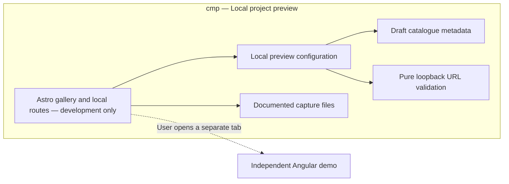

# Component diagram — local project preview

## Context

Source specification: ../../specs/local-project-preview.md. UC1 lets the maintainer inspect
a draft without publishing it. No lifecycle or personal-data model is introduced.

## Diagram

## Notes

- Production emits no local route or capture endpoint.
- The portfolio never imports or builds the Angular application.
- Capture bytes remain outside public/ and are served only by guarded local endpoints.
