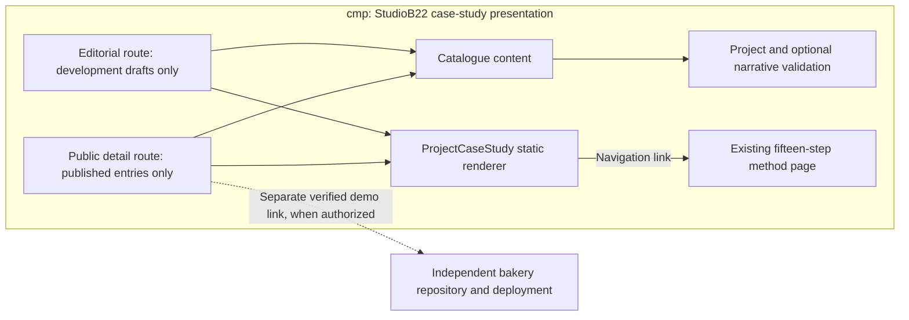

# Component diagram: project case-study presentation

> Source specification: [Maison Doree case study](../../specs/maison-doree-case-study.md).
> Related decisions: ADR-0002 static content-first architecture; existing local
> portfolio consolidation. Content/route conception and local editorial implementation
> approved by the owner on 2026-10-12; publication remains unauthorized.

## Context

Explain the approved shared narrative renderer and the boundary that excludes
drafts from production. This is a structural view, not proof of implementation.
Existing public UC2/UC4 cover the actor goals; no new actor diagram is needed.

## Diagram

## Notes

- Arrows show content/validation/rendering dependencies; navigation is labelled.
- Local route is absent from production; adding narrative does not publish a draft.
- Existing visual-preview capture schema is unchanged; no fake screenshot or commit.
- No bakery source import, iframe, client script, form, backend or new PII flow.
- Mermaid is a structural index, not strict native UML component notation.
- The shared renderer has source/generated-build verification recorded in the
  specification. That is not browser acceptance or visual diagram validation.
- Current-version bakery captures and their provenance remain pending; source
  commit availability does not establish visual evidence or publication approval.
