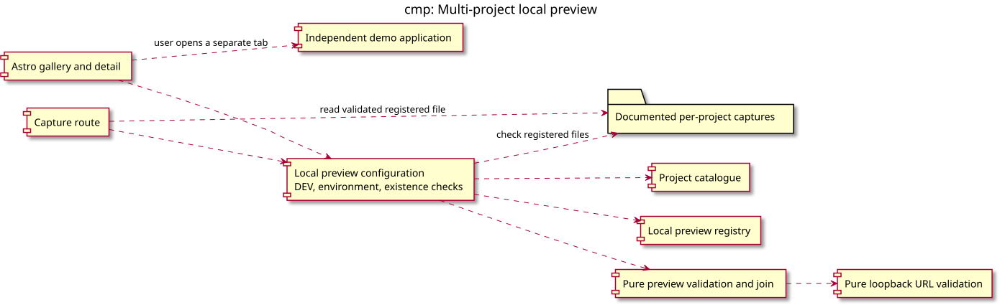

# Component view: multi-project local preview

Source: [multi-project specification](../../specs/multi-project-local-preview.md),
Data and responsibilities / Routes and migration. Decisions: retain the existing static,
development-only boundary and keep independent demo applications external.

## Context

This view answers where validation, IO and project data belong. It extends the existing
preview component view; it is not a publication lifecycle or deployment diagram.

## Diagram

## Notes

- Arrows represent dependencies, except the explicitly labelled user navigation to the demo.
- Pure validation imports neither Astro nor filesystem APIs.
- Registered file checks happen at configuration time; requests cannot choose arbitrary paths.
- Production gating applies to routes as well as the view configuration.
