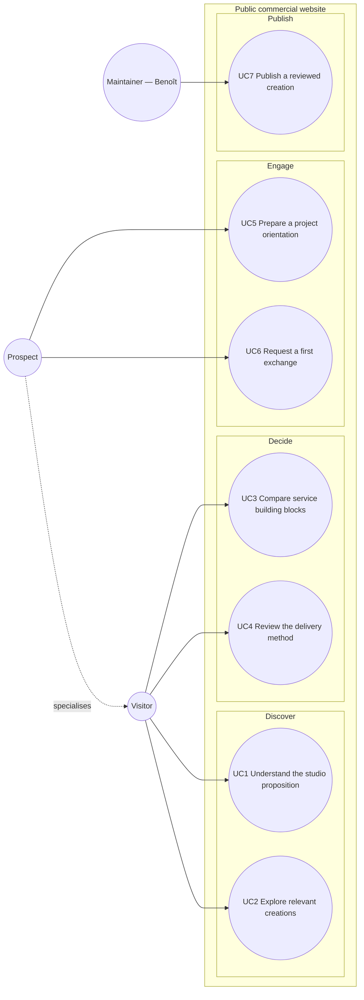

# uc — Public website — visitor and maintainer goals

> **Feature**: [issue #1 — Design the public commercial website MVP](https://github.com/StudioB22/website/issues/1)
>
> **Source specification**: [`public-website-mvp.md` § 4](../../specs/public-website-mvp.md#4-use-cases)
>
> **Related ADRs**: ADR-0001, ADR-0003

## Context

This diagram identifies actor-initiated goals inside the public website boundary. It does not model
page navigation, implementation components, the future client portal, or unavailable provider flows.

## Diagram

## Notes

- `Prospect` specialises `Visitor`, inherits its discovery goals, and owns only the additional enquiry goals.
- UC5 belongs to release 1.1. UC6 starts with monitored email in release 1.0; connected alternatives
  remain inactive until their privacy, security, provider, and operating gates pass.
- Authenticated client and collaborator goals are intentionally absent under ADR-0001.
