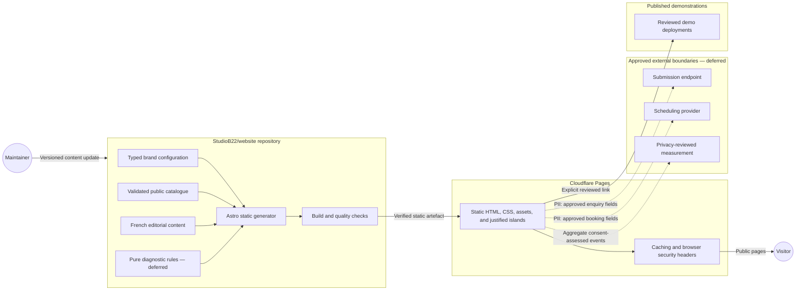

# Component diagram — public website — static delivery boundary

> **Feature**: [issue #1 — Design the public commercial website MVP](https://github.com/StudioB22/website/issues/1)
>
> **Source specification**: [`public-website-mvp.md` § 2–3](../../specs/public-website-mvp.md#2-functional-requirements)
>
> **Related ADRs**: ADR-0001, ADR-0002, ADR-0003

## Context

This diagram shows the build-time and runtime boundaries of the public product. Deferred external
services appear only to make the future egress points explicit; they are not selected or implemented.

## Diagram

## Notes

- Private GitHub repositories never become runtime inputs.
- Dotted edges are inactive until provider-specific conception and approval are complete.
- Every PII-bearing edge is labelled so privacy review cannot be skipped.
- The future client portal is a separate system boundary under ADR-0001.
