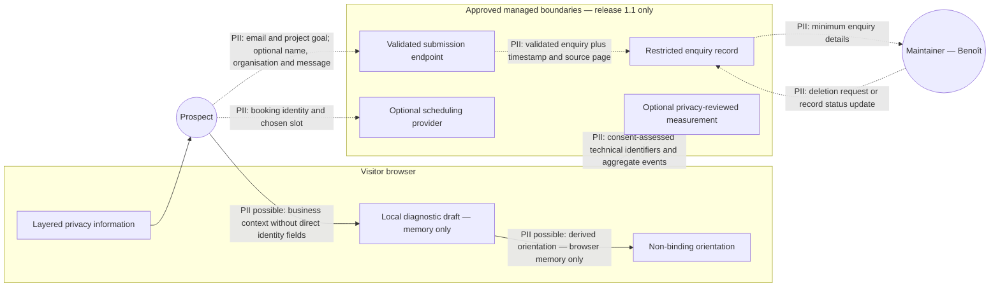

# Data-flow diagram — public website — release 1.1 qualification

> **Feature**: [issue #1 — Design the public commercial website MVP](https://github.com/StudioB22/website/issues/1)
>
> **Source specification**: [`public-website-mvp.md` — REQ-DATA-001](../../specs/public-website-mvp.md#req-data-001--control-enquiry-data)
>
> **Related ADRs**: ADR-0001, ADR-0004

## Context

This diagram identifies the personal-data boundaries planned for release 1.1. It does not select a
provider or authorise collection. Every dotted flow remains inactive until the field schema, legal
basis, processor terms, retention, deletion, security, accessibility, and operating process pass
review.

## Diagram

## Notes

- Unsubmitted diagnostic answers remain in browser memory and disappear when the journey ends.
- The diagnostic does not request health, legal, financial, authentication, or other sensitive details.
- A free-text field, if retained, warns the prospect not to submit confidential or sensitive data.
- Enquiry data is never copied into measurement events or reused for marketing without a separate,
  valid choice and process.
- A provider-specific sequence diagram becomes justified only after a provider is selected.
