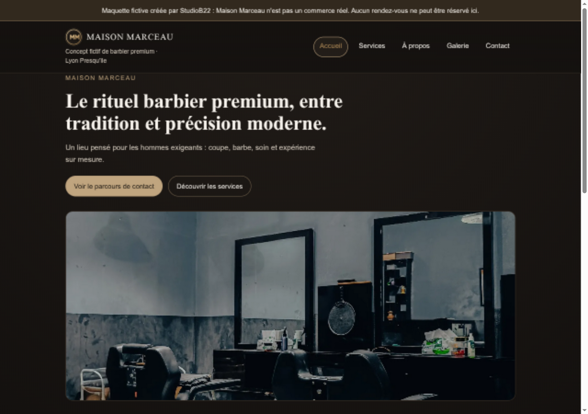
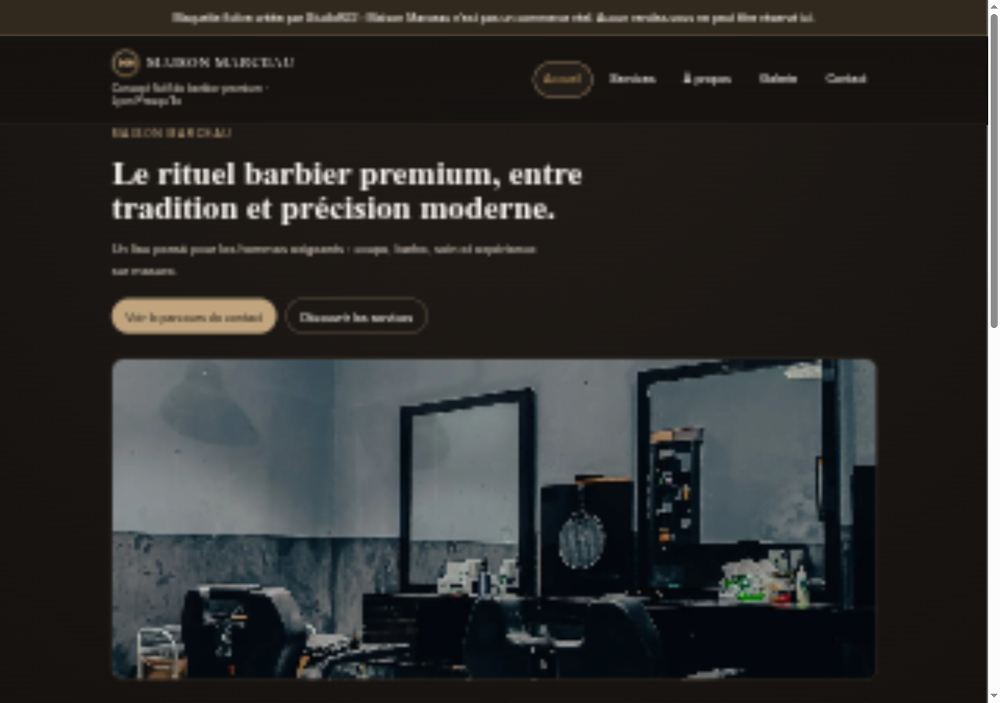
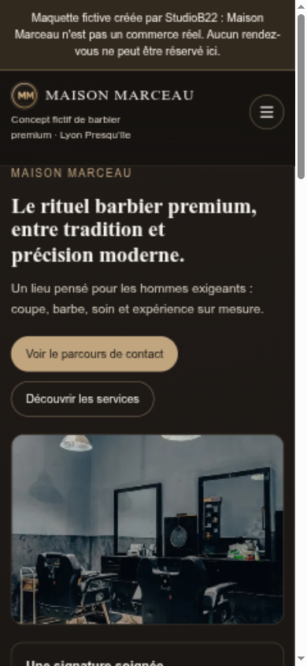

# Maison Marceau — portfolio capture package

Status: review-only, not publication approval. Capture date: 2026-10-02.

## Source status update, 2026-10-13

The independent application's dependency and keyboard corrections were merged in
[StudioB22/barbier-01#4](https://github.com/StudioB22/barbier-01/pull/4), commit
`44b3d2dee6eaa00974fd78730b2f0541c3333bec`. Application CI, dependency audit and
secret scan passed on that merge commit. Tracking evidence is recorded in
[StudioB22/website#12](https://github.com/StudioB22/website/issues/12).

The captures below still depict `8c8bb05`, not the newly merged application.
They remain dated local review references. New source verification does not
refresh their provenance or satisfy the remaining publication gates.

## Current captures — merged candidate 8c8bb05

- Exact source: 8c8bb05898280f4d636555b5f0b0fb27a9adfb70, clean barbier-01-ci worktree.
- Fresh Angular production build completed on 2026-10-02. Compiled browser output was
  served on loopback port 4402, without a remote deployment.
- Native collaborative browser, unretouched viewport captures after fonts and images loaded.
- Desktop viewport: 1280 × 900 CSS pixels; mobile viewport: 390 × 844 CSS pixels.
- Document client/scroll widths matched: 1265/1265 desktop and 375/375 mobile.
- The fictional-business notice is visible in both captures. The hero loaded the
  pexels-34865582.webp fallback in both sessions; this is not evidence of optimal mobile
  responsive-image selection or performance.
- Stored PNG dimensions: desktop 1280 × 900 pixels; mobile 780 × 1688 pixels
  (2× device scale). The displayed image aspect ratios are unchanged.
- Existing provenance and publication gates below still apply. A static home-page server
  does not verify deployed SPA routing, TLS, headers, or nested routes.

The development-only portfolio endpoints now serve these versioned files. The older
desktop.png and mobile.png remain unchanged as archived evidence.

## Archived baseline — reproducible source

- Project: StudioB22/barbier-01, independent Angular repository.
- Exact commit: 2600fe308c4d8214168f0c8ac7c8c3e16cb66900.
- Source isolated in a detached local worktree, without the original worktrees' unfinished deployment or visual changes.
- Fresh production build passed. Browser served its compiled output on a loopback HTTP server; no remote deployment was created.
- Captures were made with the native collaborative browser, without image generation, retouching, added device frames, or removal of the fictional-business notice.

## Archived captures — 2600fe3

Desktop viewport: 1280 × 900 CSS pixels. Mobile viewport: 390 × 844 CSS pixels. PNG dimensions are recorded from the stored files below.

- Desktop: desktop.png, 1280 × 900 pixels.
- Mobile: mobile.png, 390 × 844 pixels.

The browser was navigated anew after resizing so responsive image selection did not retain a larger cached source. Mobile selected pexels-34865582-480.webp; desktop selected the 1600-pixel fallback. Document client/scroll widths were equal (375/375 mobile; 1265/1265 desktop). The fictional-business notice was present in both renderings.

These are viewport captures, not full-page screenshots or comprehensive acceptance tests. The local static server is used for home-page capture only; it does not establish deployed SPA routing, TLS, cache, headers, or direct access to nested routes.

## Provenance and usage limits

UI concept and implementation: StudioB22; final ownership/publication approval must still be established.

Visible hero photograph: Halem Mumtaz Mahal, [Vintage barbershop interior](https://www.pexels.com/photo/vintage-barbershop-interior-with-empty-chairs-34865582/), photo 34865582. Source attribution and the [Pexels licence](https://www.pexels.com/license/) were rechecked on 2026-10-02. The licence permits website use and modification without compulsory attribution, but prohibits implied endorsement and stock-platform redistribution.

The source depicts an Indonesian interior, not real Maison Marceau premises in Lyon. Incidental products and small chair marks remain visible. The licence does not establish all depicted third-party permissions. Preserve the fictional/illustrative context, and do not claim universal legal clearance.

The source repository's documentation/image-inventory.md retains the complete photo inventory. No AI-generated asset is used in these captures.

## Proposed portfolio copy

- Title: Maison Marceau — un univers de barbier premium.
- Sector: Beauty and wellness.
- Status: mock-up / fictional concept, not client work.
- Summary: Un concept de site vitrine pour barbier : présenter les prestations, installer une ambiance et guider les visiteurs sur mobile comme sur ordinateur.
- Visual direction: Elegant and minimal.
- Demonstrated: multipage navigation, illustrative services/prices, mobile navigation, local responsive photography, and an explanatory contact journey.
- Not demonstrated: actual appointment booking, form submission, payment, commercial results, or an operational barber business.
- Proposed desktop alt: Accueil de la maquette fictive Maison Marceau, avec présentation des prestations et photographie d’illustration d’un salon de barbier.
- Proposed mobile alt: Accueil mobile de la maquette fictive Maison Marceau, avec navigation repliée, présentation et photo d’illustration.

Use the existing unpublished maison-marceau catalogue draft as the integration baseline; this document does not duplicate or override its publication state.

## Remaining publication gates

1. Approve the selected captures and the final stable candidate.
2. Repeat keyboard/zoom acceptance after the mobile-first navigation changes; do not transfer approval from an older candidate.
3. Complete the pending hosting/security, dependency, accessibility, performance and demo-maturity review on the final candidate. Existing local measurements are not field metrics or certification.
4. Establish and review the independent HTTPS demo, if a demonstration link is to be included.
5. Populate review dates only from completed evidence, then explicitly approve catalogue publication.
6. Only then optimise/copy approved images into public assets and publish the project card.

No catalogue entry was published, no assets added under public/, and no unfinished barbier work was changed in this capture task.
